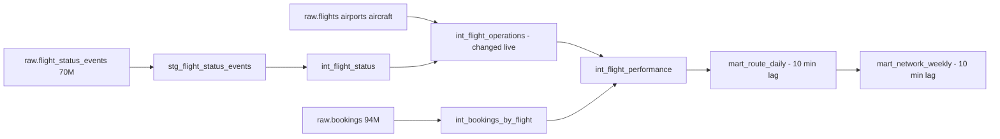

# Change the middle of a dynamic table DAG, safely (dbt + Snowflake + GitHub Actions)

The question this demo answers:

> A critical model in the middle of a long dynamic table pipeline changes. How do we test it,
> prove nothing 2-3 hops downstream breaks, and do it without rerunning everything?

**Answer:** rebuild and test only the slice of the DAG the change touches, in a zero-copy clone
of prod, and compare it to prod before it ships. The same steps run in the dev loop, in CI on
every pull request, and in the approval-gated prod deploy.

---

## The pipeline

Seven dbt models, all materialized as **INCREMENTAL dynamic tables** (dbt Projects on Snowflake,
dbt 1.12.3), on ~165M rows of synthetic airline data:



- **Refresh schedule.** Intermediate models use `TARGET_LAG = DOWNSTREAM`; the two marts use `'10 minutes'`. Snowflake runs the refreshes in prod.
- **Per-target scheduling.** The `dt_schedule()` macro gives dev and CI a dbt-managed refresh (`scheduler = DISABLE`), so tests never read a half-refreshed table.
- **What the live change touches.** `int_flight_operations` ignores the ops delay code that `int_flight_status` already carries. Surfacing it changes 4 of the 7 models. The two heavy upstream models (70M and 94M rows) are never rebuilt.

## How a change is tested

| Step | Dev (CoCo + `dbt-slice-test` skill) | CI (`dbt-pr.yml`) | Prod (`dbt-deploy.yml`) |
|---|---|---|---|
| Isolate | `CALL ops.sp_clone_for_ci('AIRLINE_DBT_DEV')` | `AIRLINE_DBT_PR_<n>` clone | approval on `dbt-prod` |
| Blast radius | `--selector changed_slice` vs prod's last successful run | same | same |
| Baseline | `snapshot_parity_baseline` (zero-copy) | same | - |
| Build | `build --selector changed_slice --full-refresh` + tests | same | same, Snowflake-managed refresh |
| Prove | `assert_parity`: rows, existing columns, still INCREMENTAL | same, sticky PR comment | smoke test, `OPS.DEPLOY_LOG` |

- **State without an artifact store.** Prod state comes straight from the prod project object, via `SYSTEM$DBT_GET_LAST_SUCCESSFUL_RUN_TARGET`. A daily `dbt compile` task keeps that state inside its 14-day window.
- **The `changed_slice` selector** covers models whose SQL changed, models that use a changed macro, and new models, plus everything downstream of them. Config differences are not a trigger, because warehouse, lag and scheduler are rendered differently per target.
- **`--full-refresh` is required.** dbt-snowflake 1.12 does not replace an existing dynamic table when only its SQL changes. Scoped to the slice, `--full-refresh` recreates exactly the changed models and their downstream.
- **What the parity check proves:**
  - row counts are unchanged
  - no existing column was removed
  - `EXCEPT` both ways on the existing columns returns 0 rows
  - the table is still `INCREMENTAL` with no fallback reason

  New columns are allowed and reported. An injected bug (dropping rows from one region) fails the check.

## Environments and identities

| | Database | GitHub identity (OIDC) | Role | Warehouse |
|---|---|---|---|---|
| Dev | `AIRLINE_DBT_DEV` | presenter (SYSADMIN) | `AIRLINE_DBT_CI_RL` owns the clone | `AIRLINE_DBT_WH` |
| CI | `AIRLINE_DBT_PR_<n>` | `SVC_GH_DBT_CI` (`environment:dbt-ci`) | `AIRLINE_DBT_CI_RL` (read-only on prod) | `AIRLINE_DBT_CI_WH` |
| Prod | `AIRLINE_DBT_PROD` | `SVC_GH_DBT_DEPLOY` (`environment:dbt-prod`, reviewer) | `AIRLINE_DBT_DEPLOY_RL` | `AIRLINE_DBT_WH`, inits on `AIRLINE_DBT_INIT_WH` |

- **How clones are created.** Cloned objects keep their original owner, so CI gets its clone from `ops.sp_clone_for_ci`. That's an owner's-rights procedure that only accepts `AIRLINE_DBT_PR_<n>` or `AIRLINE_DBT_DEV`, then hands the clone to the CI role. CI never gets write access to prod.
- **Secrets.** `SNOWFLAKE_ACCOUNT` is the only GitHub secret. The service users only accept connections from GitHub-hosted runners (Snowflake-managed `GITHUBACTIONS_GLOBAL` network rule).
- **Query tags.** Every CI and deploy statement carries `gh:dbt:<pr:n|prod>:<sha>:<run>:<step>`.

## Layout

```
dbt/airline/          dbt project: models/, macros/ (dt_schedule, parity), selectors.yml, profiles.yml
scripts/ci/dbt_ci.py  one command per workflow step (stdlib + Snowflake CLI)
scripts/presenter_walkthrough.sql   live demo runbook with the CoCo prompts
scripts/reset.sh, reset.sql         return GitHub + Snowflake to baseline
skills/dbt-slice-test/              team skill CoCo uses for the dev test loop
sql/00_account/       one-time bootstrap (run in order, ACCOUNTADMIN / SYSADMIN)
sql/raw/, sql/data_gen/, sql/ops/   raw tables, generator, deploy log, state keeper task
../.github/workflows/dbt-pr.yml, dbt-deploy.yml   (repo root)
```

## From scratch

1. Run `sql/00_account/01..07` in order, then `sql/raw/tables.sql`, `sql/data_gen/*.sql` and `sql/ops/*.sql`.
2. Load the data on a large warehouse:
   ```sql
   USE DATABASE airline_dbt_prod;
   CALL data_gen.sp_generate_airline_data(1.0, 'ALL');   -- about 4 min on XLARGE
   ```
3. Deploy the prod project and build it:
   ```bash
   snow dbt deploy AIRLINE_DBT_PROD_PROJECT --source dbt/airline --database AIRLINE_DBT_PROD --schema DBT \
     --dbt-version 1.12.3 --default-target prod --external-access-integration AIRLINE_DBT_PKG_EAI
   ```
   ```sql
   EXECUTE DBT PROJECT airline_dbt_prod.dbt.airline_dbt_prod_project ARGS = 'build --target prod';
   ```
4. GitHub: create environments `dbt-ci` (no protection) and `dbt-prod` (required reviewer, branch `main`). Tag the baseline `dbt-baseline-v1` and `dbt-prod-last-good`.

The change is made live by CoCo. A validated reference copy lives on the `dbt-solution` branch.

## Reset

```bash
bash DBT-Actions/scripts/reset.sh [connection]   # PRs, branches, DBT-Actions/ on main, clones, deploy log, prod slice
```
