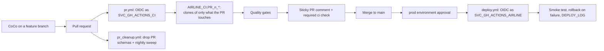

# Snowflake CI/CD with Cortex Code (Airline pipeline demo)

A reusable demo of **what good Snowflake CI/CD looks like**, with Cortex Code (CoCo) working
inside the loop. A pipeline change (replacing a full-refresh task with an incremental dynamic
table) goes from a feature branch, to a pull request checked in a right-sized zero-copy test
environment, to an approval-gated, audited, self-healing production deploy. Auth is
**GitHub OIDC end to end: no Snowflake credentials are stored in GitHub.**

---

## Architecture



| Piece | Name |
|---|---|
| Prod database | `AIRLINE_PROD` (`STAGING`, `CURATED`, `DATA_GEN`, `OPS`) |
| PR test database | `AIRLINE_CI` (one schema pair per open PR, retention 0) |
| Prod deploy identity | `SVC_GH_ACTIONS_AIRLINE` - OIDC `environment:prod` - role `PROD_GH_ACTIONS_DEPLOY_RL` |
| PR check identity | `SVC_GH_ACTIONS_CI` - OIDC `pull_request` (+ `ref:refs/heads/main` for the sweeper) - role `AIRLINE_CI_RL` |
| Warehouses | `AIRLINE_DEMO_WH` (SMALL, prod), `AIRLINE_CI_WH` (XSMALL, CI) |
| Deploy audit | `AIRLINE_PROD.OPS.DEPLOY_LOG` + `QUERY_TAG = 'gh:prod:<sha>:<run>:<file>'` |
| GitHub | public repo; `main` ruleset (PR + `ci` check); `prod` environment (required reviewer) |
| Only GitHub secret | `SNOWFLAKE_ACCOUNT` |

### Right-sized PR environments
Real PRs are usually small (a column, a type change, one model). So a PR does **not** get a
full copy of prod. `scripts/ci/ci.py` reads the diff and clones only the prod tables the
change reads, plus the incumbent its parity tests compare against, and redeploys any repo
object downstream of what changed. A docs-only PR touches nothing in Snowflake. Clones are
zero-copy; the schemas are dropped when the PR closes and a nightly sweeper removes orphans.

### Quality gates (`ci` check)
| Gate | Blocking | Check |
|---|---|---|
| Deploy into PR environment | yes | changed + downstream SQL applies cleanly |
| Dynamic table refresh mode | yes | `INCREMENTAL`, no fallback reason |
| Incremental behavior | yes | localized batch (`tests/gates/incremental_batch.sql`) refreshes `INCREMENTAL`, small rewrite |
| Parity vs incumbent | yes | `tests/parity/*.sql` (row count, EXCEPT both ways, aggregates) |
| Team standards | yes | repo conventions enforced in CI; the PR comment names any gap |
| SQL lint (sqlfluff) | advisory | reported only |
| Cost of this run | info | queries, seconds, GB scanned on `AIRLINE_CI_WH` |

### Prod deploy
Approval-gated (`prod` environment). Each statement is query-tagged with the commit SHA; each
step is logged to `OPS.DEPLOY_LOG`; a smoke test verifies changed objects. On failure, new
objects are dropped and changed objects are re-applied from the `prod-last-good` tag.

---

## Repo layout

```
.github/workflows/
  pr.yml             PR checks (required "ci" status)
  pr_cleanup.yml     drop PR schemas on close + nightly orphan sweep
  deploy.yml         approval-gated prod deploy, smoke test, rollback
scripts/
  ci/ci.py           CI engine (scope, PR env, gates, comment, deploy, rollback) - stdlib + snow CLI
  presenter_walkthrough.sql   live demo script
  reset.sql          Snowflake reset            reset_git.sh   GitHub reset
  apply_baseline.sql from-scratch build order
sql/00_account/      one-time ACCOUNTADMIN bootstrap (never deployed by CI)
sql/staging/ sql/curated/ sql/data_gen/ sql/ops/   pipeline objects (one file per object)
tests/gates/         CI-owned gate SQL          tests/parity/  per-change parity tests (added by PRs)
skills/              object-parity-test, change-documentation (mirrors of the CoCo skills)
COCO.md              conventions CoCo follows in this repo
```

The dynamic table and its parity test are authored **live** by CoCo; they are not on `main`.
A validated reference copy lives on the `solution` branch as a fallback.

---

## Demo flow (details in `scripts/presenter_walkthrough.sql`)
1. Tour the legacy pipeline: a task fully rebuilds the KPI mart every 10 minutes.
2. Tour the platform: OIDC identities, one secret, ruleset, `prod` environment, workflows.
3. CoCo authors the dynamic table + a parity test on a branch and opens a PR.
4. CI builds `AIRLINE_CI.PR_<n>_*`, runs the gates, and posts the results on the PR.
5. If a check fails: "The CI check failed - fix it." CoCo reads the run, fixes it, pushes. Green.
6. Merge. Approve the `prod` deployment in GitHub. Deploy, smoke test, `prod-last-good`.
7. Traceability: `DEPLOY_LOG`, query tags in `QUERY_HISTORY`, PR schemas already gone.

You intervene at: the CoCo prompts, and the prod approval click.

## Reset
```bash
snow sql -f scripts/reset.sql -c <connection>   # PR schemas, prod DT, deploy log, legacy mart
bash scripts/reset_git.sh                       # close PRs, delete branches, main -> baseline-v1
```
Bulk data is preserved. The schedule spans roughly -270..+90 days from generation; regenerate
(see `scripts/apply_baseline.sql`) when "upcoming flights" run out.

Note: GitHub Actions is already configured. The `snowflake-cicd-github-actions` skill is a
one-time setup tool and is not used anywhere in this demo flow (see `COCO.md`).
