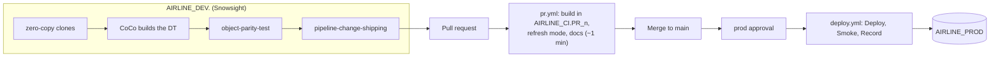

# Snowflake CI/CD with Cortex Code (Airline pipeline demo)

A reusable demo of a practical Snowflake development loop, driven from **Snowsight**:

1. **Develop** in a personal sandbox schema of zero-copy clones, with CoCo writing the change and
   proving it matches what it replaces.
2. **Ship** it through a pull request: CoCo packages the file using the team's published skills;
   a thin CI job (about a minute) validates it.
3. **Deploy** behind an approval, with an audit trail, a smoke test and automatic rollback.

The change: replace a full-refresh task with an incremental dynamic table. Auth is **GitHub OIDC
end to end: no Snowflake credentials are stored in GitHub.**

---

## Three environments



| Environment | Where | Who / what | Purpose |
|---|---|---|---|
| Dev sandbox | `AIRLINE_DEV.<you>` | you (SYSADMIN), by hand | clones of the tables the change needs; build and prove parity |
| CI | `AIRLINE_CI.PR_<n>` | `SVC_GH_ACTIONS_CI` (OIDC `pull_request`), role `AIRLINE_CI_RL` | build the changed objects against prod inputs, read-only; dropped every run |
| Prod | `AIRLINE_PROD` | `SVC_GH_ACTIONS_AIRLINE` (OIDC `environment:prod`), role `PROD_GH_ACTIONS_DEPLOY_RL` | approval-gated deploy |

Warehouses: `AIRLINE_DEMO_WH` (SMALL, prod + sandbox), `AIRLINE_CI_WH` (XSMALL, CI).
Only GitHub secret: `SNOWFLAKE_ACCOUNT`.

### Team skills instead of a hidden instructions file
The team's conventions live in two **published skills** in the Snowflake skill catalog, visible
to anyone with SYSADMIN, and bundled in the `Data Engineering` CoCo profile
(`CORTEX_CODE.CONFIG.DATA_ENGINEERING`):

| Skill | What it does |
|---|---|
| `object-parity-test` | Proves the new object matches the one it replaces (row count, EXCEPT both ways, aggregates) and that a dynamic table refreshes incrementally. Runs only in the dev sandbox. |
| `pipeline-change-shipping` | Turns the sandbox change into the repo file: team layout, prod names, table + column comments in the definition, standard commit message. |

Source for both is in `skills/`.

### CI: thin and visible (`ci` check)
Each check is its own step in the Actions log:

| Step | Check |
|---|---|
| Plan | which pipeline objects the PR changes (no Snowflake) |
| Validate | build them in `AIRLINE_CI.PR_<n>` reading prod inputs read-only; dynamic tables use `INITIALIZE = ON_SCHEDULE`, so nothing is computed |
| Check refresh mode | every changed dynamic table is `INCREMENTAL` |
| Check documentation | table comment + every column comment |
| Report / Clean up | one sticky PR comment; the schema is dropped |

Data parity is proven in the sandbox, not re-run in CI. CI can never write to prod: the CI role
has only SELECT there, and `ci.py` refuses any rendered statement that targets `AIRLINE_PROD`.

### Prod deploy
Approval-gated (`prod` environment). **Deploy** applies the changed SQL with
`QUERY_TAG = 'gh:prod:<sha>:<run>:<file>'`; **Smoke test** checks the deployed objects;
**Record** writes `AIRLINE_PROD.OPS.DEPLOY_LOG` and moves the `prod-last-good` tag. On failure,
new objects are dropped and changed objects are re-applied from `prod-last-good`.

---

## Repo layout

```
.github/workflows/
  pr.yml             PR checks (required "ci" status)
  deploy.yml         approval-gated prod deploy: Deploy, Smoke test, Record
scripts/
  ci/ci.py           one command per workflow step - stdlib + snow CLI
  presenter_walkthrough.sql   live demo script
  reset.sql          Snowflake reset            reset_git.sh   GitHub reset
  apply_baseline.sql from-scratch build order
sql/00_account/      one-time bootstrap (never deployed by CI)
sql/staging/ sql/curated/ sql/data_gen/ sql/ops/   pipeline objects (one file per object)
skills/              source of the published team skills
```

The dynamic table is authored **live**; it is not on `main`. A validated reference copy lives on
the `solution` branch as a fallback.

---

## Demo flow (details in `scripts/presenter_walkthrough.sql`)
1. Tour the legacy pipeline: a task fully rebuilds the KPI mart every 10 minutes.
2. Tour the three environments, the OIDC identities, the team skills and the profile.
3. Create your sandbox: four `CLONE` statements (by hand, seconds, no storage).
4. CoCo (Snowsight): build the incremental dynamic table in the sandbox.
5. CoCo: run `object-parity-test` (parity + incremental proof).
6. In the Workspace, create a branch. CoCo: run `pipeline-change-shipping` to write the file and
   the commit message. Commit, push, open the PR.
7. Watch CI tick through its steps (about a minute). Merge.
8. Approve the `prod` deployment. Deploy, smoke test, record.
9. Traceability: `DEPLOY_LOG`, query tags, the CI schema already gone.

## Reset
```bash
snow sql -f scripts/reset.sql -c <connection>   # sandbox, PR schemas, prod DT, deploy log, legacy mart
bash scripts/reset_git.sh                       # close PRs, delete branches, main -> baseline-v1
```
Bulk data is preserved. The schedule spans roughly -270..+90 days from generation; regenerate
(see `scripts/apply_baseline.sql`) when "upcoming flights" run out.
